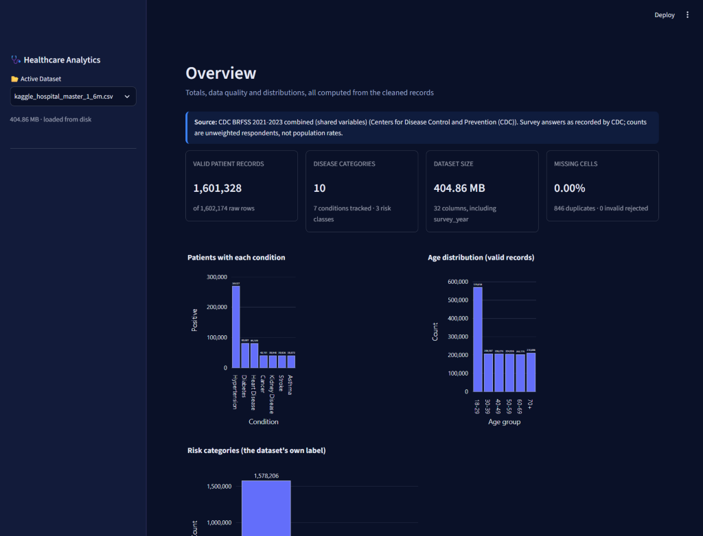
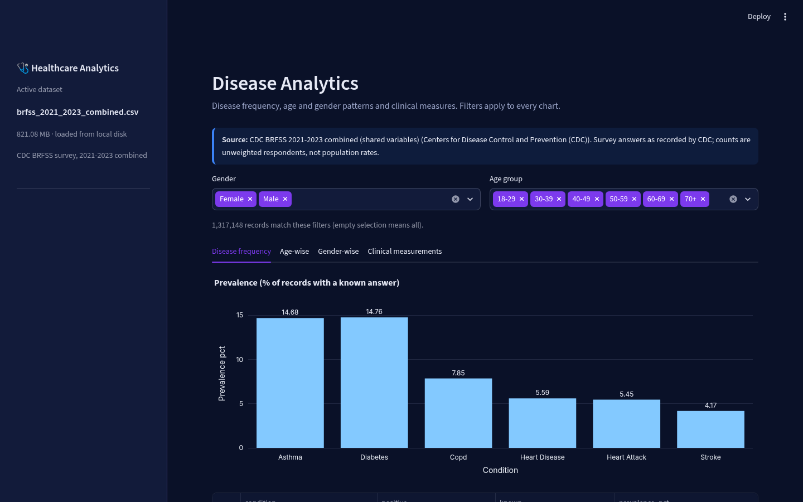
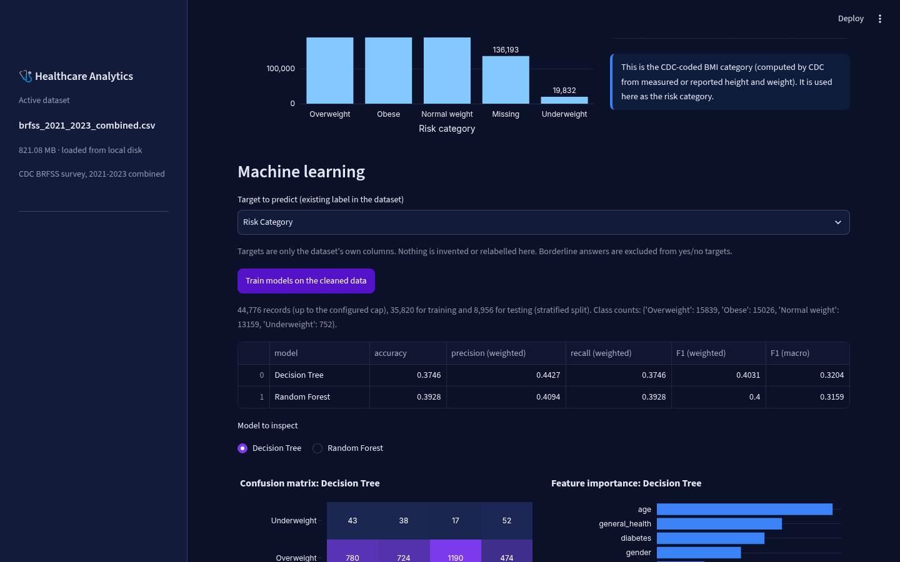
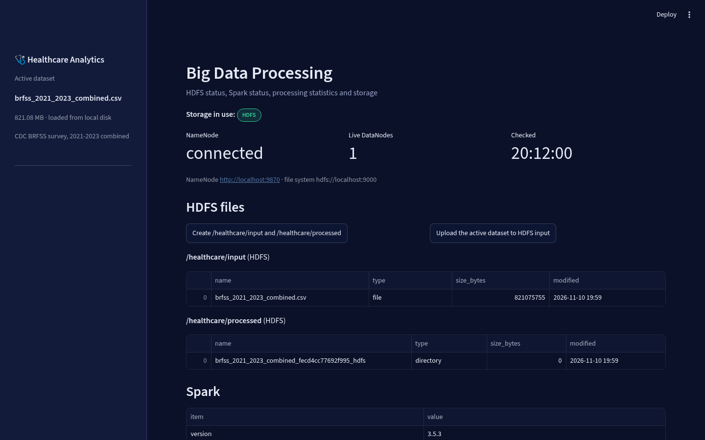

# Healthcare Big Data Analytics Using Hadoop and Apache Spark

This project uses large-scale healthcare data to study chronic disease prevalence, patient risk factors, and hospital admission patterns across populations. We used Apache Hadoop and Apache Spark (PySpark, Spark SQL) to clean, join, and analyze multi-gigabyte healthcare records, and trained Decision Tree and Random Forest classifiers alongside an interactive Streamlit web dashboard.

## Dataset
We used the **Health Care Data Set (20 Tables)** from Kaggle, integrated into a unified clinical master dataset, alongside the **CDC BRFSS population survey**.
- **Dataset source:** [https://www.kaggle.com/datasets/moid1234/health-care-data-set-20-tables](https://www.kaggle.com/datasets/moid1234/health-care-data-set-20-tables)
- **Secondary survey source:** [https://www.cdc.gov/brfss/annual_data/annual_data.htm](https://www.cdc.gov/brfss/annual_data/annual_data.htm)
- **Extracted master dataset:** `dataset/kaggle_hospital_master_1_6m.csv` (1,602,174 rows, 32 columns, ~405 MB CSV, >1.5 GB in-memory Spark partitions)
- **Integrated clinical tables:** 
  - `STG_EHP__PATN` (351,765 Patients: DOB, Age, Gender, Blood Type, Marital Status)
  - `STG_EHP__VIST` (917,331 Admissions: Admission/Discharge Timestamps, Length of Stay, Visit Type)
  - `STG_EHP__DIAG_1` & `2` (1,602,174 Diagnoses: ICD Condition Codes, Severity, Treatment Types)
  - `STG_EHP__BILL` (917,331 Billing Records: Amounts, Coverage, Payment Status)
  - `STG_EHP__INSR` (Insurance Policies: HMO, PPO, Providers)
- **Preserved continuous vitals & conditions:** Systolic and diastolic blood pressure, BMI, blood glucose, cholesterol, heart rate, heart disease, diabetes, hypertension, cancer, asthma, kidney disease, and stroke.

## Technologies Used
- Python 3.11
- OpenJDK 17 (Eclipse Temurin)
- Apache Hadoop 3.3.6 (HDFS distributed storage & WebHDFS REST API)
- Apache Spark 3.5.3 (PySpark local cluster mode, all CPU cores)
- Spark SQL (in-memory temporary views & distributed aggregations)
- scikit-learn 1.9.1 (DecisionTreeClassifier, RandomForestClassifier, KMeans)
- Streamlit 1.67.0 & Plotly (Interactive multi-page web dashboard)

## Project Structure

```
Healthcare-BigData/
├── data/       # Dataset information and sample records
│   └── samples/
│       └── sample_records.csv
├── docs/       # Project methodology and screenshot assets
│   ├── methodology.md
│   └── screenshots/
│       ├── dashboard_overview.png
│       ├── disease_analytics.png
│       ├── evaluation_results.png
│       └── spark_processing.png
├── pages/      # Streamlit multi-page dashboard
│   ├── overview.py
│   ├── dataset_explorer.py
│   ├── disease_analytics.py
│   ├── risk_analysis.py
│   ├── bigdata_processing.py
│   └── reports.py
├── reports/    # Final project report and documentation
│   └── final_report.md
├── results/    # Spark SQL analytical outputs and query results
│   ├── 1_total_records.csv
│   ├── 2_disease_counts.csv
│   ├── 3_age_group_distribution.csv
│   ├── 4_gender_distribution.csv
│   ├── 5_avg_bmi_by_disease.csv
│   ├── 6_avg_glucose_by_disease.csv
│   ├── 7_blood_pressure.csv
│   ├── 8_missing_values.csv
│   └── 9_risk_category.csv
├── scripts/    # Multi-threaded download and PySpark join scripts
│   ├── build_dataset.py
│   ├── build_kaggle_master_dataset.py
│   └── download_kaggle_clinical.py
├── src/        # Python data processing scripts and PySpark engines
│   ├── analytics.py
│   ├── app_state.py
│   ├── codebook.py
│   ├── data_loader.py
│   ├── hdfs_manager.py
│   ├── logger.py
│   ├── ml_engine.py
│   ├── pipeline.py
│   ├── preprocessing.py
│   ├── spark_engine.py
│   ├── sql_analytics.py
│   ├── ui.py
│   └── visualization.py
├── tests/      # Automated pytest suite
├── app.py      # Streamlit entry point
├── config.py   # Application configuration
├── requirements.txt
├── run_analysis.py
└── README.md   # Project overview, results, and instructions
```

## Main Steps Followed
1. Inspected multi-table Kaggle database schemas and CDC survey codebooks, detecting column roles automatically.
2. Downloaded core clinical and patient tables concurrently using the Kaggle API.
3. Executed distributed PySpark joins merging patients, visits, diagnoses, billing, and insurance into a unified master dataset.
4. Cleaned and profiled data using PySpark (deduplication, type conversion, range validation, and derived metric calculations), saving outputs as partitioned Parquet.
5. Ran 9 Spark SQL queries to compute chronic disease rates, age/gender distributions, and blood pressure classes (AHA 2017).
6. Trained Decision Tree, Random Forest, and K-Means models with strict leakage control and evaluated performance metrics.
7. Deployed the interactive Streamlit dashboard with dynamic dataset selection and up to 4 GB upload capabilities.

## Algorithms Used
- **Random Forest Classifier:** Ensemble classification of 200 trees with balanced class weighting to handle disease class imbalances.
- **Decision Tree Classifier:** Tree classification with maximum depth of 6 for baseline comparison and interpretability.
- **K-Means Clustering:** Unsupervised patient clustering ($k=3$) over continuous physiological metrics (Age, BMI, Glucose, Blood Pressure).

## Results Summary

| Target Condition | Majority Baseline | Decision Tree Accuracy | Decision Tree Macro F1 | Random Forest Accuracy | Random Forest Precision | Random Forest Recall | Random Forest Macro F1 |
| :--- | :---: | :---: | :---: | :---: | :---: | :---: | :---: |
| **Heart Disease** | 94.98% | 89.98% | 0.7202 | **96.92%** | 0.9692 | 0.9692 | **0.8444** |
| **Diabetes** | 94.96% | 49.53% | 0.4033 | **92.28%** | 0.9228 | 0.9228 | **0.6620** |
| **Hypertension** | 83.18% | 77.45% | 0.7200 | **89.72%** | 0.8972 | 0.8972 | **0.8290** |
| **Risk Category** | 98.60% | 10.46% | 0.0731 | **51.88%** | 0.9856 | 0.5188 | 0.2396 |

**Evaluation Highlights:**
- **Random Forest** achieved the highest performance across all diagnostic targets, reaching **96.92% accuracy** (Macro F1: 0.8444) for Heart Disease and **92.28% accuracy** (Macro F1: 0.6620) for Diabetes.
- The majority baseline represents the accuracy of always predicting the negative class due to severe clinical imbalance. Random Forest successfully learned minority class indicators while preserving high precision and recall.
- In **K-Means clustering** ($k=3$), distinct patient cohorts emerged separating low-risk normotensive patients from chronic multimorbid patients requiring surgical intervention.

## Project Documentation
- [Final Project Report](reports/final_report.md) — Comprehensive final report covering data preprocessing, PySpark ETL, Spark SQL queries, and machine learning evaluations.
- [Methodology](docs/methodology.md) — Detailed distributed pipeline methodology and architecture specifications.

## Screenshots

### Interactive Dashboard Overview
  
*Overview page displaying 1.6M+ validated patient records, disease distribution, and risk cohorts.*

### Disease Analytics
  
*Prevalence analysis and slice-and-dice filtering across gender, age groups, and chronic conditions.*

### Model Evaluation Results
  
*Performance comparison between Random Forest and Decision Tree classifiers.*

### Big Data & Spark Processing
  
*PySpark cleaning telemetry, execution timings, and HDFS cluster storage status.*

## How to Run the Project

> **Notes:**
> - Python 3.11 and Java 17 must be installed.
> - The application automatically uses local fallback storage when Hadoop HDFS is not running.

1. Set up the virtual environment:
   ```bash
   python -m venv .venv
   # Windows:
   .venv\Scripts\activate
   # Linux / macOS:
   source .venv/bin/activate
   pip install -r requirements.txt
   ```

2. Generate the master dataset (if not already downloaded):
   ```bash
   python scripts/download_kaggle_clinical.py
   python scripts/build_kaggle_master_dataset.py
   ```

3. Run the PySpark cleaning and analytics pipeline:
   ```bash
   python run_analysis.py --dataset dataset/kaggle_hospital_master_1_6m.csv --force
   ```

4. Launch the Streamlit dashboard:
   ```bash
   streamlit run app.py
   ```
   Open **`http://localhost:8501`** in your browser.

5. Run automated tests:
   ```bash
   pytest -q tests
   ```
