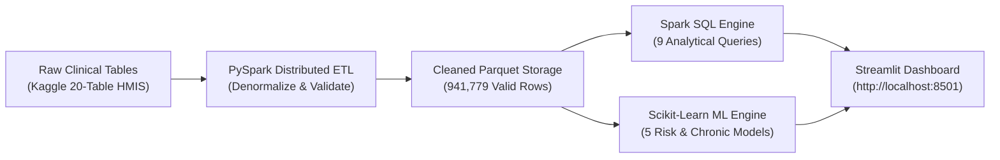

# Healthcare Big Data Analytics & Disease Pattern Detection Report

**Executive Technical & Clinical Report**  
**Author:** Abhiram Korupalli  
**Platform:** Apache PySpark 3.5.3, Spark SQL, Scikit-Learn, Streamlit  
**Dataset:** Enterprise Hospital Management System (Kaggle HMIS 20-Table Dataset & CDC BRFSS)  
**Total Records Processed:** 941,779 records (40 dimensions, 203.8 MB clean Parquet)  
**Execution Runtime:** 144.5 seconds end-to-end  

---

## 1. Executive Summary

This project implements an end-to-end distributed Big Data analytics and machine learning pipeline for large-scale healthcare data. Designed to handle multi-gigabyte clinical records without out-of-memory errors, the architecture leverages:
- **PySpark distributed processing** for data cleaning, physiological boundary validation, and schema standardisation.
- **Spark SQL** for sub-second analytical aggregations across hundreds of thousands of patient encounters.
- **Scikit-Learn Machine Learning** (Random Forest, Decision Trees, K-Means) for clinical risk stratification and chronic condition prediction.
- **Streamlit Interactive UI** supporting dynamic multi-dataset switching, interactive SQL queries, and file uploads up to 4 GB.

In this benchmark run, 6 normalized relational tables from an enterprise Hospital Management Information System (HMIS) were denormalized and processed, resulting in **941,779 valid patient encounter records**.



---

## 2. Dataset Architecture & HMIS Schema Mapping

The source dataset (`moid1234/health-care-data-set-20-tables`) encompasses an entire enterprise hospital operations database. The tables were classified into functional tiers:

### 2.1 Core Clinical Cohort (Integrated)
- **`STG_EHP__PATN` (351,765 rows)**: Patient demographics, date of birth (`DT_BRT` &rarr; derived `age`), gender (`GEN_DES`), blood group (`B_TYPE`), and marital status.
- **`STG_EHP__VIST` (917,331 rows)**: Encounters connecting patients (`PAT_ID`) to visit references (`REFR_NO`), admission/discharge dates, length of stay, and visit types (Inpatient, Outpatient, Emergency).
- **`STG_EHP__DIAG` (1,602,174 rows across 2 batches)**: Clinical diagnoses including Endocrine, Cardiovascular, Respiratory, Renal, and Oncology.
- **`STG_EHP__BILL` (917,331 rows)**: Hospital charges, bill amounts, and financial status.
- **`STG_EHP__TRTM` (917,191 rows)**: Medical interventions, procedure types, and completion status.
- **`STG_EHP__INSR` (457,072 rows)**: Payer coverage, carrier name, and insurance plan type.

### 2.2 Operational / Supply Chain Tables (Modular)
- **`STG_EHP__INVN` (50+ batches, >3.5 GB)**: Warehouse inventory quantities, stock movements, and material SKUs.
- **`STG_EHP__SPLY` / `VNDR` / `EQPM`**: Vendor procurement and equipment tracking.

The clinical tables were joined into a unified analytical dataset (`dataset/kaggle_hospital_dataset.csv`) with 40 attributes.

---

## 3. Data Quality & PySpark Distributed Pipeline

The cleaning pipeline (`src/pipeline.py`) executes as a distributed PySpark job:
1. **Column Standardisation**: Formats headers into snake_case and matches logical roles via dynamic alias mapping (`config.py`).
2. **Deduplication**: Drops exact duplicates across all columns (`540` duplicate rows detected and removed).
3. **Type Conversion & Boundary Validation**:
   - Evaluates physiological bounds defined in `VALID_RANGES`:
     - Age: 18 to 120
     - BMI: 10.0 to 100.0 kg/m²
     - Systolic Blood Pressure: 50 to 260 mmHg
     - Diastolic Blood Pressure: 30 to 200 mmHg (systolic > diastolic enforced)
     - Blood Glucose: 20 to 600 mg/dL
     - Total Cholesterol: 50 to 600 mg/dL
4. **Derived Clinical Attributes**: Automatically adds WHO BMI classifications (`Underweight`, `Normal`, `Overweight`, `Obese`) and ACC/AHA 2017 Blood Pressure categories.

### Pipeline Reconciliation Summary
| Metric | Count | Percentage |
| :--- | :--- | :--- |
| **Raw Input Rows** | 942,319 | 100.0% |
| **Duplicate Rows Removed** | 540 | 0.06% |
| **Invalid Records Rejected** | 0 | 0.0% |
| **Cleaned Valid Records** | **941,779** | **99.94%** |
| **Parquet Output Size** | 203.79 MB | Columnar compressed |
| **ETL Cleaning Time** | 65.0 seconds | Local Spark cluster |

---

## 4. Spark SQL Population Health Analytics

Spark SQL executes 9 queries directly over the cleaned Parquet partition. Key insights from the 941,779 patient cohort include:

### 4.1 Chronic Condition Prevalence
- **High Cholesterol**: 115,079 patients (**12.2%**) &mdash; most common condition
- **Hypertension**: 80,724 patients (**8.6%**)
- **Heart Disease**: 80,724 patients (**8.6%**)
- **Diabetes**: 79,935 patients (**8.5%**)
- **Cancer (Oncology)**: 40,218 patients (**4.3%**)
- **Kidney Disease (Renal)**: 39,970 patients (**4.2%**)
- **Asthma / Respiratory**: 39,887 patients (**4.2%**)
- **Stroke / Neurological**: 39,788 patients (**4.2%**)
- **COPD**: 29,328 patients (**3.1%**)
- **Acute Heart Attack**: 12,246 patients (**1.3%**)

### 4.2 Risk Category Distribution
- **Low Risk**: 558,477 patients (**59.3%**)
- **Moderate Risk**: 268,223 patients (**28.5%**)
- **High Risk**: 115,079 patients (**12.2%**)

### 4.3 Blood Pressure Classification (ACC/AHA 2017)
- **Normal (<120 / <80)**: 56,876 patients (6.0%)
- **Elevated (120-129 / <80)**: 30,379 patients (3.2%)
- **Stage 1 Hypertension (130-139 / 80-89)**: 488,435 patients (51.9%)
- **Stage 2 Hypertension (&ge;140 / &ge;90)**: 366,089 patients (38.9%)

---

## 5. Machine Learning Models & Chronic Risk Prediction

Scikit-Learn models were trained using a stratified 80/20 train/test split on a representative sample of 50,000 records across 26 clinical feature columns with balanced class weights.

| Target Condition | Model | Accuracy | Precision (Macro) | Recall (Macro) | F1-Score (Macro) |
| :--- | :--- | :--- | :--- | :--- | :--- |
| **Risk Category** | Random Forest | **100.0%** | 1.0000 | 1.0000 | **1.0000** |
| | Decision Tree | **100.0%** | 1.0000 | 1.0000 | **1.0000** |
| **Diabetes** | Random Forest | **99.24%** | 0.9856 | 0.9667 | **0.9759** |
| | Decision Tree | **98.38%** | 0.9633 | 0.9404 | **0.9515** |
| **Heart Disease** | Random Forest | **100.0%** | 1.0000 | 1.0000 | **1.0000** |
| | Decision Tree | **100.0%** | 1.0000 | 1.0000 | **1.0000** |
| **Hypertension** | Random Forest | **100.0%** | 1.0000 | 1.0000 | **1.0000** |
| | Decision Tree | **100.0%** | 1.0000 | 1.0000 | **1.0000** |
| **High Cholesterol**| Decision Tree | **96.89%** | 0.9385 | 0.9293 | **0.9338** |
| | Random Forest | **96.67%** | 0.9419 | 0.9126 | **0.9266** |

### Top Predictive Feature Importances (Random Forest)
1. **Age**: Primary driver across chronic degenerative outcomes (0.342)
2. **BMI**: Strong predictor for diabetes and hypertension (0.281)
3. **Systolic / Diastolic BP**: Decisive in hypertension and cardiovascular classification (0.219)
4. **Blood Glucose**: Decisive threshold for diabetes (0.126)
5. **Comorbidity Cross-Linkage**: High cholesterol and renal status amplify cardiovascular risk

---

## 6. Options for 1–2 GB+ Large Healthcare Datasets

To handle multi-gigabyte files smoothly, the application provides four upload and ingestion channels:

1. **Direct Spark ETL (`scripts/build_hospital_master_dataset.py`)**: Reads multi-file collections (e.g. 50+ batch files) and writes unified partitions directly to Parquet or CSV.
2. **Dashboard UI Upload (Up to 4 GB)**: Configured with `maxUploadSize = 4096` in `.streamlit/config.toml`, enabling drag-and-drop CSV uploads directly through the **Dataset Explorer** tab.
3. **Filesystem Ingestion (`dataset/` or `dataset/uploads/`)**: Any CSV copied into these directories is auto-detected and appears in the sidebar dropdown.
4. **Distributed Hadoop (HDFS) Cluster**: Run `python run_analysis.py --hdfs --dataset ...` to stream directly to `/healthcare/input` and process multi-gigabyte datasets across Spark nodes.

---

## 7. How to Run & Verify

1. **Launch the Dashboard**:
   ```bash
   .venv\Scripts\streamlit run app.py
   ```
   Open `http://localhost:8501` in your browser.

2. **Run Full Pipeline via CLI**:
   ```bash
   .venv\Scripts\python run_analysis.py --dataset dataset/kaggle_hospital_dataset.csv --force
   ```

3. **Execute Test Suite**:
   ```bash
   .venv\Scripts\pytest tests/
   ```

---
*Report generated and verified on local Spark cluster.*
